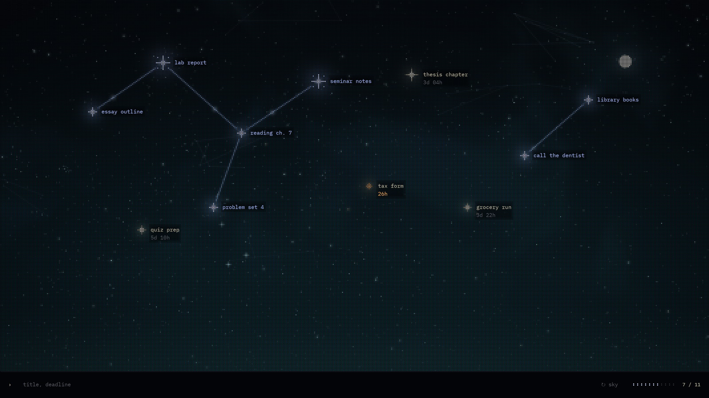
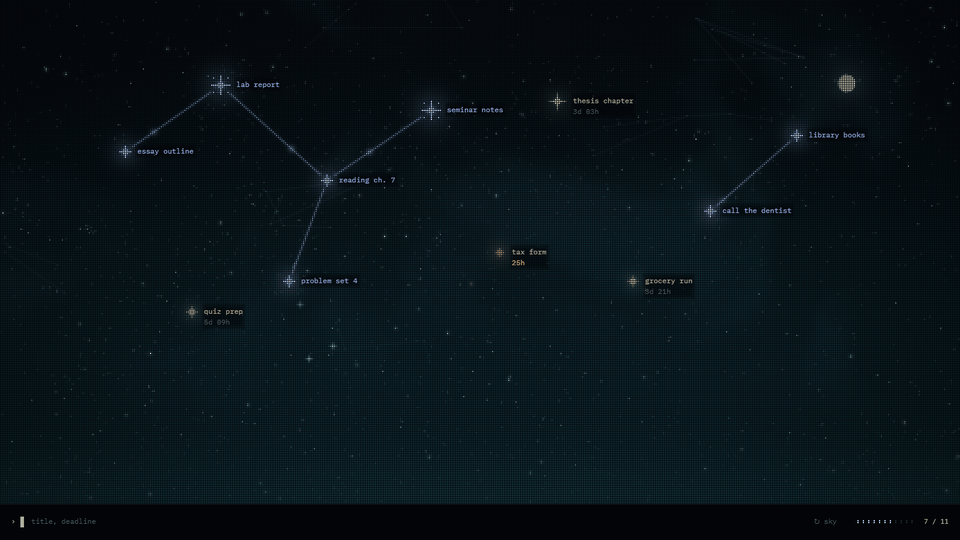
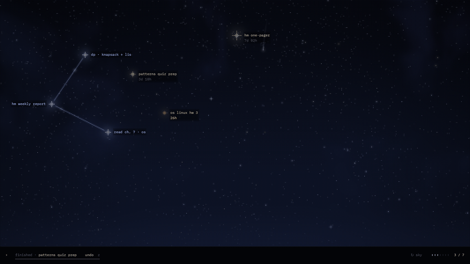
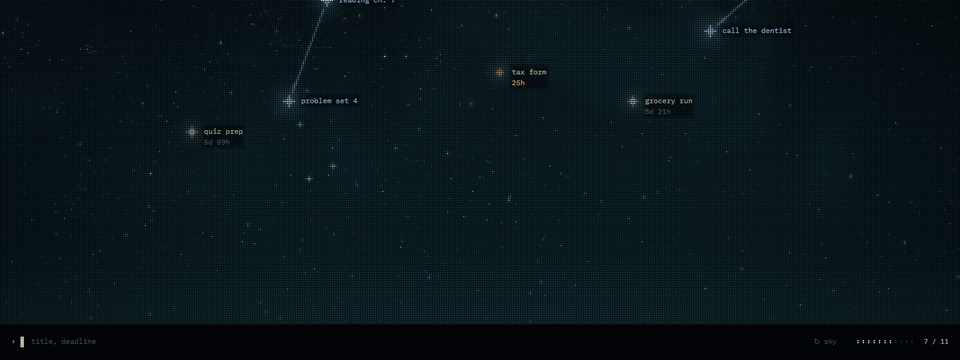
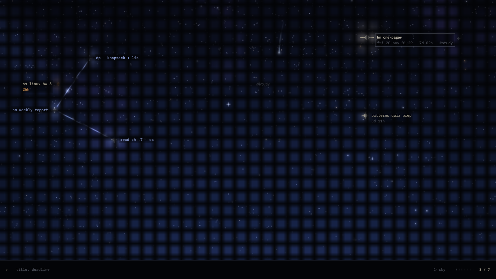
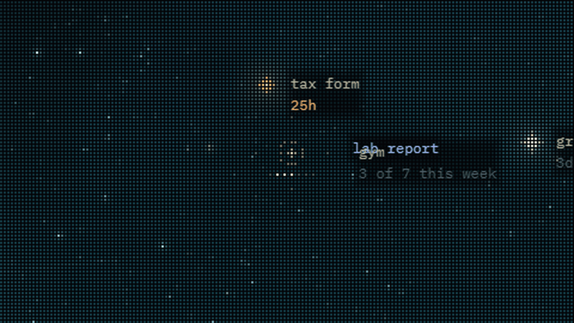

<p align="center">
  
</p>

<h1 align="center">Night Sky</h1>

<p align="center">
  ✦ a todo list where every task is a star ✦
</p>

<p align="center">
  <a href="https://aroki1.github.io/night-todos/"></a>
  <a href="LICENSE"></a>
  
  
  
</p>

<p align="center">
  <a href="https://aroki1.github.io/night-todos/"><strong>Web app</strong></a>
  &nbsp;·&nbsp;
  <a href="#install">Install</a>
  &nbsp;·&nbsp;
  <a href="#writing-stars">Syntax</a>
  &nbsp;·&nbsp;
  <a href="#controls">Controls</a>
  &nbsp;·&nbsp;
  <a href="#development">Development</a>
</p>

## What it is

write a task. a star lights up.<br>
the deadline is its life — warm at first, amber when time runs short.<br>
finish it, and it flares and reaches for the last thing you did.<br>
by friday, your week has a shape.<br>
miss one, and it quietly burns out. no red badges, no guilt.

and when the week ends, the night ends with it. 🌅

<p align="center">
  <a href="docs/media/weekly-morning.mp4"></a>
</p>
<p align="center"><sub>The weekly morning. Click for the full-quality video.</sub></p>

## Features

<table>
  <tr>
    <td width="50%"><a href="docs/media/create.mp4"></a></td>
    <td width="50%" valign="top"><h3>Create</h3>type <code>essay, fri</code>. press enter.<br>it's in the sky.</td>
  </tr>
  <tr>
    <td width="50%"><a href="docs/media/finish.mp4"></a></td>
    <td width="50%" valign="top"><h3>Finish</h3>click a star.<br>watch it join the others.<br><sub>changed your mind? undo stays open for five seconds.</sub></td>
  </tr>
  <tr>
    <td width="50%"><a href="docs/media/steps.mp4"></a></td>
    <td width="50%" valign="top"><h3>Steps</h3>big tasks carry small moons.<br>each one you finish pulses into the core.</td>
  </tr>
  <tr>
    <td width="50%"><a href="docs/media/weekly-morning.mp4"></a></td>
    <td width="50%" valign="top"><h3>The weekly morning</h3>every monday, last week gets a sunrise.<br>a flower for everything you did.</td>
  </tr>
  <tr>
    <td width="50%"><a href="docs/media/thought.mp4"></a></td>
    <td width="50%" valign="top"><h3>Thoughts</h3>no deadline? it's a thought: a soft haze above the bar.<br>say when, and it becomes a star.</td>
  </tr>
  <tr>
    <td width="50%"></td>
    <td width="50%" valign="top"><h3>Groups</h3>add <code>#study</code>. lines connect only stars of the same group.<br>each area of life gets its own corner of the sky.</td>
  </tr>
  <tr>
    <td width="50%"><a href="docs/media/practice.mp4"></a></td>
    <td width="50%" valign="top"><h3>Practices</h3>something you do again and again.<br>mark the day; a ring of weeks fills in. no streaks, no zeros.</td>
  </tr>
  <tr>
    <td width="50%"></td>
    <td width="50%" valign="top"><h3>Past weeks</h3>old weeks drift away, but never disappear.<br>hover one to see its name.<br><sub>lost? type <code>/help</code>.</sub></td>
  </tr>
</table>

## Writing stars

Press `n` or `/`, then write a title, a comma and a deadline:

```text
essay, fri
weekly report, tomorrow 18:00 / outline / draft
launch notes, +3d !
call the landlord #home
```

- The deadline comes after the last comma.
- Add steps after the deadline, each one after ` / ` (a slash with spaces around it).
- End with ` !` for a bigger star. A leading `!` works too.
- Add `#tag` anywhere to put the star in a group (letters, digits and `-`, up to 16). It is removed from the title.
- Leave the deadline out (no comma, or nothing after it) and you have a thought, not a star. The bar then asks "when?". Answer with a deadline from the table below (steps and `!` work there too) to make it a star, or `remind <when>` (`remind +2h`, `remind fri 9:00`) to bring it back at that time. `Esc` or an empty Enter keeps it as a thought.

| Kind | Examples |
| --- | --- |
| Relative | `today`, `tonight`, `tomorrow 18:00`, `tmr`, `+3d`, `+5h`, `+90m` |
| Weekday | `fri`, `sat 18:00`, `wed 9am` (the next one, never today if the time has passed) |
| Date | `nov 20`, `20 nov`, `20.11`, `20/11`, `2026-12-01 8:00` |

A date without a time means 23:59. A date that has already passed reads as "that's already gone". A date without a year means the next time it comes around.

## Controls

| | Desktop | Touch | Keyboard |
| --- | --- | --- | --- |
| Write a star | click the bar | tap the bar | `n` or `/` |
| Finish a star | click it | tap to select, tap again | `Tab` to select, `Enter` |
| Finish a step | click its row | tap its row | `Space` finishes the next step, `1`-`5` toggle a row |
| Delete a step | hover a row, `Delete` | hold a row | `Delete` over a row |
| Undo | click `undo` | tap `undo` | `z` |
| Move between stars | hover for a label | tap | `Tab`, `Shift+Tab` |
| Mark a practice | click it | tap to select, tap again | `Enter` or `Space` on a selected one; `y` marks yesterday |
| Answer a thought | click its haze | tap its haze | `Tab` to select it |
| Let a thought go | `Delete` on an empty answer | hold the haze | `Delete`, then `Enter` |
| Close help or clear | click the sky | tap the sky | `Esc` |

In the bar, type a command instead of a task:

- `/help` opens the short reference.
- `/practice <title> [#tag]` starts a practice. `/practice` lists them, `/practice stop <name>` archives one, `/practice limit <n>` sets how many you can keep (5 by default, up to 20).
- `/export` downloads a JSON backup; `/import` restores one.
- `/motion on|off|system` sets reduced motion. The default follows your system setting.

## The weekly morning

every monday, the night ends.<br>
a sun rises over a valley made of dots.<br>
every task you finished has grown into a flower. 🌼<br>
the ones you're carrying stand as buds.<br>
name the week, if you like.<br>
then the sun sets, and the meadow turns back into stars.

<sub>It plays the first time you open the app in a new week. Click or press Space to hurry the sunrise; Enter or Esc lets the sun set. Type a name, or a task with a deadline to start the new week with it.</sub>

## thought, word, deed

a thought is only haze.<br>
say when, and it becomes a star.<br>
do it, and it joins the constellation. ✨<br>
nothing resets. nothing scolds.

<p align="center">
  <a href="docs/media/thought.mp4"></a>
</p>
<p align="center"><sub>A thought, a date, a star. Click for the full-quality video.</sub></p>

<sub>A thought you leave alone comes back by itself, only while you are in the app and at most once an hour. Practices keep a week of dots under the star and, on hover, a ring of weeks; a missed day is a dim grain, never a zero.</sub>

## Install

**Web and phone.** Open the [web app](https://aroki1.github.io/night-todos/). Use your browser's install action, or "Add to Home Screen" on a phone, for a standalone app. After the first load it works offline.

**Desktop.** The desktop build is a [Tauri 2](https://tauri.app) shell around the same files. There is no published installer yet, so build it from source with Rust and the Tauri prerequisites for your platform:

```powershell
npm install
npm run desktop:build
```

Installers are written under the Cargo target directory in `release/bundle/`. The desktop build also sends a notification when a task turns urgent or its deadline passes.

## Privacy

your sky lives on your device. no account, no server, no tracking.

Tasks, preferences and weekly history live in the browser's local storage (or the desktop app's). There is no account, no server and no analytics. The app makes no network requests of its own; the service worker only caches the app's files, and the one font, IBM Plex Mono, is served from the same place. Back up or move your data with `/export` and `/import`.

## How it works

there are no images in Night Sky. only dots.

Everything is drawn into one grain framebuffer, a grid of small dots, and presented through WebGL with a 2D canvas fallback. Only the labels are canvas text. Each moment in the app, such as a finish, an undo, a deadline passing or the weekly morning, is a pure function of time and its inputs, so a frame depends only on the sky time `T`. That makes it possible to step the app frame by frame, which is how the clips above were rendered. There is no framework and no build step: the files in `app/` are the files that run. `npm run verify` checks the result against golden screenshot hashes and a frame-time budget.

See [docs/dev/ARCHITECTURE.md](docs/dev/ARCHITECTURE.md) for the module map and rules, and [docs/DESIGN.md](docs/DESIGN.md) for the visual system.

## Development

```powershell
npm run dev       # static server on http://127.0.0.1:5173
npm test          # 279 selftests in Node
npm run verify    # tests, import rules, shell check, golden hashes, perf budget
npm run shell     # regenerate the service worker shell after changing app/
npm run record    # re-render the clips in docs/media (needs the dev server and ffmpeg)
```

```text
app/        the web app and PWA: static ES modules, no build
desktop/    the Tauri shell
docs/       design, architecture, testing notes, media
scripts/    dev server, shell generator, tests, verification, recorder
```

Dev URL parameters (`demo=1`, `scene=`, `clock=`, `morning=1`, and more) are listed in [docs/TESTING.md](docs/TESTING.md).

## License

[MIT](LICENSE)
