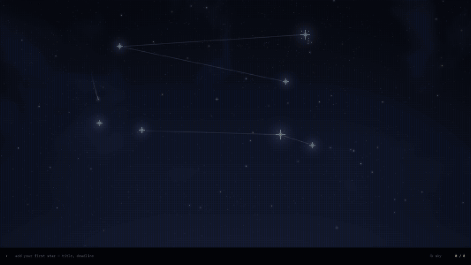
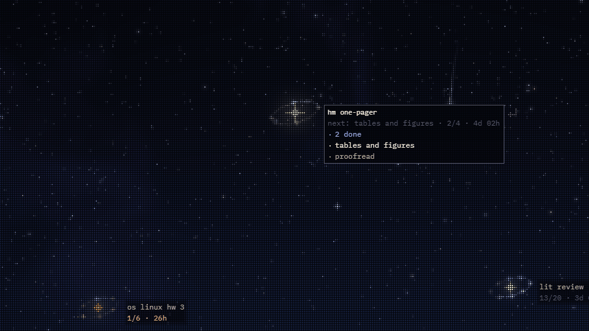
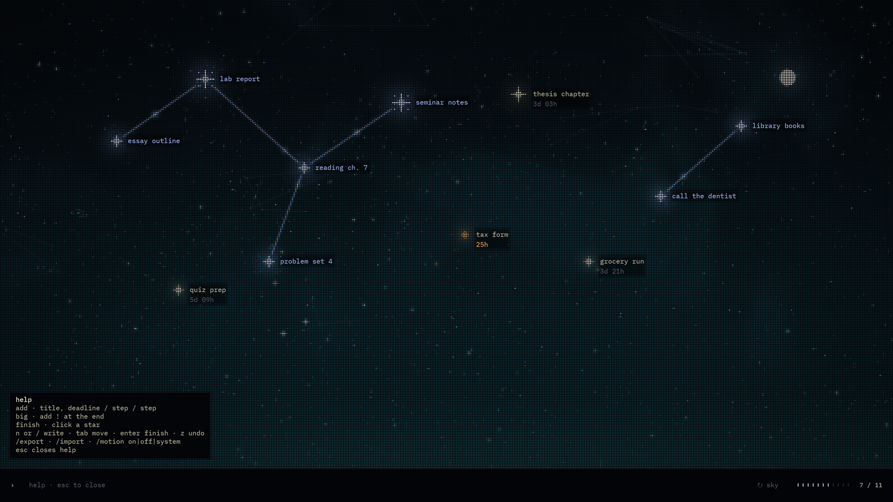

<p align="center">
  
</p>

<h1 align="center">Night Sky</h1>

<p align="center">
  A todo list where every task is a star.<br>
  Finish one and it joins the week's constellation. Miss one and it burns out.
</p>

<p align="center">
  <a href="https://aroki1.github.io/night-todos/"></a>
  <a href="LICENSE"></a>
  
  
  
</p>

<p align="center">
  <a href="https://aroki1.github.io/night-todos/"><strong>Web app</strong></a>
  &nbsp;·&nbsp;
  <a href="#install">Install</a>
  &nbsp;·&nbsp;
  <a href="#writing-stars">Syntax</a>
  &nbsp;·&nbsp;
  <a href="#controls">Controls</a>
  &nbsp;·&nbsp;
  <a href="#development">Development</a>
</p>

## What it is

Night Sky is a small, quiet todo app. You write a task with a deadline and it appears as a star in a night sky. The deadline is the star's life: it warms toward amber as it gets close. When you finish it, it flares, turns blue-white and draws a line to the last thing you finished, so the week slowly becomes a constellation. When the week is over, the sky opens into a short morning that grows a flower for everything you did.

Everything is drawn as grain: one framebuffer of small dots, with no framework and no images. It runs in any modern browser, installs as a PWA, and keeps your data on your device.

<p align="center">
  <a href="docs/media/weekly-morning.mp4"></a>
</p>
<p align="center"><sub>The weekly morning. Click for the full-quality video.</sub></p>

## Features

<table>
  <tr>
    <td width="50%"><a href="docs/media/create.mp4"></a></td>
    <td width="50%" valign="top"><h3>Create</h3>Write <code>essay, fri</code> and watch a preview star appear where the new task will go. Press Enter and it assembles. Add steps with <code>/</code> and a big star with <code>!</code>.</td>
  </tr>
  <tr>
    <td width="50%"><a href="docs/media/finish.mp4"></a></td>
    <td width="50%" valign="top"><h3>Finish</h3>Click a star. It flares, a ring leaves it, and a line travels to the constellation. It stays blue-white for the rest of the week. Undo is open for five seconds.</td>
  </tr>
  <tr>
    <td width="50%"><a href="docs/media/steps.mp4"></a></td>
    <td width="50%" valign="top"><h3>Steps</h3>A task can carry steps. They orbit the star, and each finished step pulses into its core. A small marker shows whether the work is keeping pace with the deadline.</td>
  </tr>
  <tr>
    <td width="50%"><a href="docs/media/weekly-morning.mp4"></a></td>
    <td width="50%" valign="top"><h3>The weekly morning</h3>Each Monday the last week closes with a morning: a flower for each finished task, a bud for each one you carry over, and a line of text for the week.</td>
  </tr>
  <tr>
    <td width="50%"></td>
    <td width="50%" valign="top"><h3>Past weeks and help</h3>Archived weeks stay in the sky as faint, distant constellations. Hover one to see its week and name. Type <code>/help</code> for a short reference at any time.</td>
  </tr>
</table>

## Writing stars

Press `n` or `/`, then write a title, a comma and a deadline:

```text
essay, fri
weekly report, tomorrow 18:00 / outline / draft
launch notes, +3d !
```

- The deadline comes after the last comma.
- Add steps after the deadline, each one after ` / ` (a slash with spaces around it).
- End with ` !` for a bigger star.

| Kind | Examples |
| --- | --- |
| Relative | `today`, `tonight`, `tomorrow 18:00`, `tmr`, `+3d`, `+5h`, `+90m` |
| Weekday | `fri`, `sat 18:00`, `wed 9am` (the next one, never today if the time has passed) |
| Date | `nov 20`, `20 nov`, `20.11`, `20/11`, `2026-12-01 8:00` |

A date without a time means 23:59. A date that has already passed reads as "that's already gone". A date without a year means the next time it comes around.

## Controls

| | Desktop | Touch | Keyboard |
| --- | --- | --- | --- |
| Write a star | click the bar | tap the bar | `n` or `/` |
| Finish a star | click it | tap to select, tap again | `Tab` to select, `Enter` |
| Finish a step | click its row | tap its row | `Space` finishes the next step, `1`-`5` toggle a row |
| Delete a step | hover a row, `Delete` | hold a row | `Delete` over a row |
| Undo | click `undo` | tap `undo` | `z` |
| Move between stars | hover for a label | tap | `Tab`, `Shift+Tab` |
| Close help or clear | click the sky | tap the sky | `Esc` |

In the bar, type a command instead of a task:

- `/help` opens the short reference.
- `/export` downloads a JSON backup; `/import` restores one.
- `/motion on|off|system` sets reduced motion. The default follows your system setting.

## The weekly morning

When a new week begins and you open the app, the old week gets its morning. The night closes, a sunrise is drawn in grain over a meadow, and wind moves the grass. Every task you finished is a flower; a task you are carrying into the new week is a bud. One of 52 short lines for the week fades in, and you can type a name for the week or a first task for the next one. Escape or Enter lets the sun set into the new night. The finished week then stays in the sky as a distant constellation.

## Install

**Web and phone.** Open the [web app](https://aroki1.github.io/night-todos/). Use your browser's install action, or "Add to Home Screen" on a phone, for a standalone app. After the first load it works offline.

**Desktop.** The desktop build is a [Tauri 2](https://tauri.app) shell around the same files. There is no published installer yet, so build it from source with Rust and the Tauri prerequisites for your platform:

```powershell
npm install
npm run desktop:build
```

Installers are written under the Cargo target directory in `release/bundle/`. The desktop build also sends a notification when a task turns urgent or its deadline passes.

## Privacy

Tasks, preferences and weekly history live in the browser's local storage (or the desktop app's). There is no account, no server and no analytics. The app makes no network requests of its own; the service worker only caches the app's files, and the one font, IBM Plex Mono, is served from the same place. Back up or move your data with `/export` and `/import`.

## How it works

Everything is drawn into one grain framebuffer, a grid of small dots, and presented through WebGL with a 2D canvas fallback. Only the labels are canvas text. Each moment in the app, such as a finish, an undo, a deadline passing or the weekly morning, is a pure function of time and its inputs, so a frame depends only on the sky time `T`. That makes it possible to step the app frame by frame, which is how the clips above were rendered. There is no framework and no build step: the files in `app/` are the files that run. `npm run verify` checks the result against golden screenshot hashes and a frame-time budget.

See [docs/dev/ARCHITECTURE.md](docs/dev/ARCHITECTURE.md) for the module map and rules, and [docs/DESIGN.md](docs/DESIGN.md) for the visual system.

## Development

```powershell
npm run dev       # static server on http://127.0.0.1:5173
npm test          # 202 selftests in Node
npm run verify    # tests, import rules, shell check, golden hashes, perf budget
npm run shell     # regenerate the service worker shell after changing app/
npm run record    # re-render the clips in docs/media (needs the dev server and ffmpeg)
```

```text
app/        the web app and PWA: static ES modules, no build
desktop/    the Tauri shell
docs/       design, architecture, testing notes, media
scripts/    dev server, shell generator, tests, verification, recorder
```

Dev URL parameters (`demo=1`, `scene=`, `clock=`, `morning=1`, and more) are listed in [docs/TESTING.md](docs/TESTING.md).

## License

[MIT](LICENSE)
