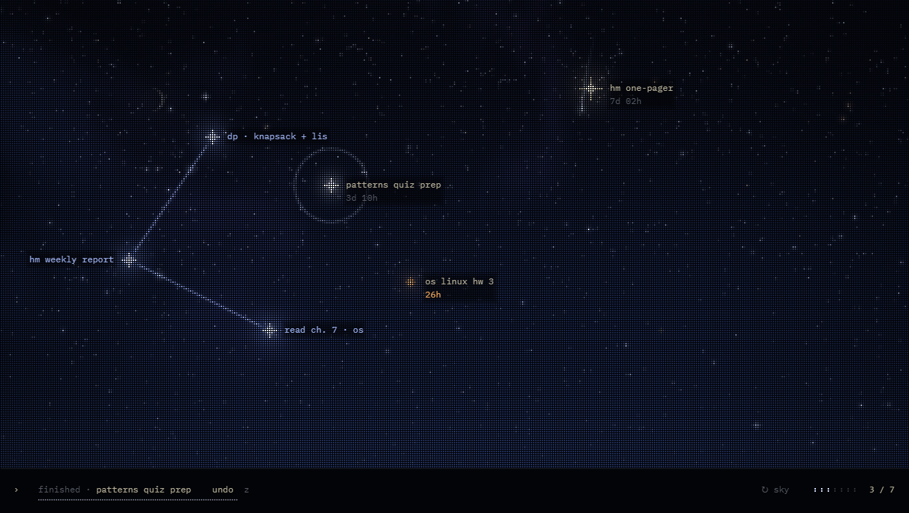
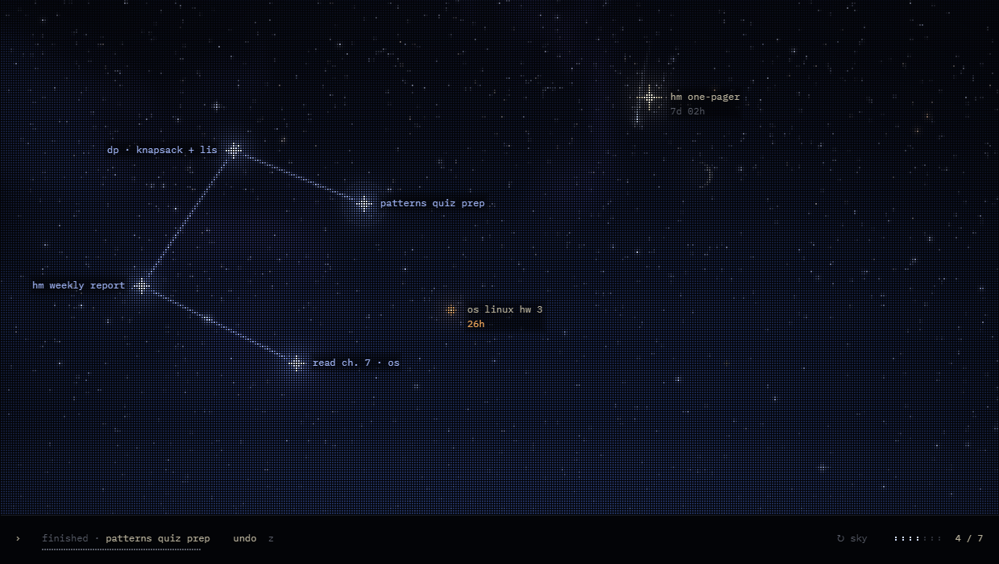

# Night Sky

A todo list where every task is a star. Finish it and it joins this week's constellation. Miss it and it burns out.






## How it works

- Each task is a star. Its arms shrink as the deadline nears.
- When it gets urgent (under a quarter of its time left), it turns amber.
- Finish it and it flares and turns cold blue-white.
- Finished stars link into the week's constellation.
- Every week has its own sky, seeded by the week number.
- On Monday the old week's constellation lifts away and settles into the distance.
- Past weeks stay in the sky as faint, drifting constellations. Hover one to see its week.

## Use it

- **Web:** `https://<you>.github.io/night-sky/` (placeholder; see Deploy).
- **Phone:** open the page, then Share, Add to Home Screen. It works offline.
- **Desktop:** run `npm run desktop:build`; the installer lands in `<cargo target dir>/release/bundle/` (`nsis/` and `msi/`).

## Adding stars

Press `n` or `/` (or tap the bar), type `title, deadline`, press Enter. Add ` !` for a big star.

| Deadline | Examples |
|---|---|
| day | `today`, `tomorrow`, `tmr`, `fri`, `sat 18:00` |
| date | `nov 20`, `20 nov`, `20.11`, `2026-11-20`, `nov 20 18:00` |
| time | `9am`, `6:30pm`, `18:00` |

Keys: `n` or `/` focus the bar, Enter adds, Esc cancels, `z` undoes for 5 seconds, Enter on a hovered star finishes it. Mouse: click a star to finish it. Touch: tap a star to select, tap again within 4 seconds to finish; tap `undo` to undo.

Bar commands (not shown in the UI): `/export` downloads your data as JSON, `/import` replaces it from a file (undo for 5 s), `/motion on|off|system` sets reduced motion.

## Privacy

Everything is stored on your device. No account, no server, no tracking. The fonts are bundled, so the app makes no third-party requests.

## Develop

```
npm install
npm run dev            # static server on http://127.0.0.1:5173
npm run desktop:dev    # Tauri window
```

Open `http://127.0.0.1:5173/?dev=1` for test hooks (`window.ns`). Run `ns.selfTest()` in the console. Useful flags: `demo=1`, `seed=7`, `clock=2026-11-13T21:00`, `t=12`, `freeze=1`, `weeks=6`, `ritual=1`, `v10parity=1`. `node scripts/parity.mjs` diffs against `prototype/v10.html`; `node scripts/cdp.mjs <url> <out.png>` takes headless Edge screenshots.

## Deploy

- **GitHub Pages:** push to `main`, then in the repo settings choose Pages, Source: GitHub Actions. `.github/workflows/pages.yml` publishes `app/`.
- **Any static host:** upload the `app/` folder. All paths are relative, so a subpath works. Bump `VERSION` in `app/sw.js` for each release.
- **Desktop:** `npm run desktop:build`.

## Project structure

```
app/        the product: static ES modules, PWA (index.html, sw.js, src/, fonts/, icons/)
desktop/    Tauri 2 shell serving app/
prototype/  v8-v10 prototypes and QA shots (history)
legacy/     the original Rust/Rune app
docs/       DESIGN.md, specs, dev notes, media
scripts/    serve.mjs, cdp.mjs, parity.mjs
```

## Design

See [docs/DESIGN.md](docs/DESIGN.md).

## History

Night Sky began as a Rust desktop app and moved through three browser prototypes (v8 to v10). It now ships as web plus Tauri: one build runs everywhere, including iPhone browsers, without needing WebGPU. The original app lives in `legacy/rune/`.

## Licence

MIT.
